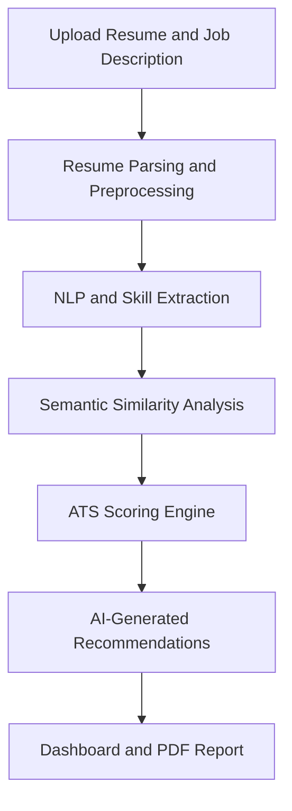

# 🎯 ATS Scorer — AI-Powered Resume Analyzer

An AI-powered web application that evaluates resumes against job descriptions, generates ATS compatibility scores, identifies skill gaps, and provides personalized recommendations to improve resumes.

Developed as a **Final Year Project**, the system combines Natural Language Processing (NLP), Machine Learning, and Generative AI to help candidates better align their resumes with job requirements.

## 🛠️ Tech Stack


## 🌐 Live Demo

[](https://appapppy-okhvappn7tymxblkwcndinm.streamlit.app/)

The frontend is deployed on Streamlit Community Cloud.
The complete resume analysis pipeline is currently available
through local execution due to cloud infrastructure memory limitations.

## ✨ Features

- **Resume Parsing:** Supports PDF, DOC and DOCX formats.
- **ATS Scoring:** Evaluates formatting, keywords, content and ATS compatibility.
- **Semantic Matching:** Measures contextual similarity between resumes and job descriptions.
- **Skill Gap Analysis:** Identifies matching and missing skills.
- **AI Recommendations:** Generates actionable feedback using the Groq API.
- **Authentication:** Supports email/password and Google sign-in through Supabase.
- **Analysis History:** Saves previous resume assessments.
- **PDF Reports:** Generates downloadable analysis reports.
- **Interactive Dashboard:** Displays scores, strengths and areas for improvement.

## 🏗️ How It Works



The system uses **Sentence Transformers and cosine similarity** to evaluate contextual relevance rather than relying solely on exact keyword matching.

## 🧠 Technologies Used

| Component | Technology |
|---|---|
| Frontend | Streamlit, CSS |
| Backend | FastAPI |
| NLP | spaCy — en_core_web_md |
| Embedding Model | all-MiniLM-L6-v2 |
| Semantic Matching | Cosine Similarity |
| Generative AI | Groq API, Llama |
| Authentication | Supabase, Google OAuth |
| Database | PostgreSQL / Supabase |
| PDF Generation | WeasyPrint, Jinja2 |
| Model Development | Jupyter Notebook, Google Colab |

## 📂 Project Structure

```text
ATS-Scorer/
├── ai/                  # AI models and research
├── Backend/
│   ├── api/             # API routes and authentication
│   ├── core/            # Configuration
│   ├── database/        # Database operations
│   ├── models/          # Data models
│   ├── services/        # NLP and scoring services
│   ├── utils/           # Utility functions
│   ├── main.py
│   └── requirements.txt
├── frontend/
│   ├── assets/          # CSS and styling
│   ├── components/      # UI components
│   ├── services/        # API integration
│   ├── views/           # Application pages
│   └── streamlit_app.py
├── Templates/
├── .gitignore
└── README.md
```

## 🚀 Getting Started

### 1. Clone the Repository

```bash
git clone https://github.com/Aashijain-coder/ATS-Scorer.git
cd ATS-Scorer
```

### 2. Create a Virtual Environment

```bash
python -m venv .venv
```

Windows:

```powershell
.\.venv\Scripts\Activate.ps1
```

Linux / macOS:

```bash
source .venv/bin/activate
```

### 3. Install Dependencies

```bash
python -m pip install -r Backend/requirements.txt
python -m pip install streamlit supabase
python -m spacy download en_core_web_md
```

WeasyPrint may require additional system libraries depending on your operating system.

### 4. Configure Environment Variables

Create a `.env` file in the location expected by your backend configuration and add the required credentials.

```env
SUPABASE_URL=your_supabase_url
SUPABASE_KEY=your_service_role_key
SUPABASE_ANON_KEY=your_anon_key
GROQ_API_KEY=your_groq_api_key
```

Configure Google OAuth in the Supabase dashboard for Google sign-in. Configure `frontend/.streamlit/secrets.toml` as required by the frontend.

**Never commit API keys or secret credentials to GitHub.**

### 5. Run the Backend

From the project root:

```bash
python -m uvicorn Backend.main:app --reload --port 8000
```

- Backend: http://localhost:8000
- API Documentation: http://localhost:8000/docs

### 6. Run the Frontend

Open a separate terminal and activate the virtual environment.

```bash
cd frontend
python -m streamlit run streamlit_app.py
```

Application: http://localhost:8501

## 📖 Usage

1. Register or sign in to your account.
2. Upload your resume.
3. Enter the target job description.
4. Generate your ATS score.
5. Review skill gaps, strengths and AI recommendations.
6. Download the detailed analysis report.

## 🔮 Future Enhancements

- Multilingual resume analysis
- Role-specific resume scoring
- Resume optimization and version comparison
- Advanced model evaluation and benchmarking
- Cloud deployment

## 🎓 About the Project

- **Project Type:** Final Year Project
- **Domain:** Artificial Intelligence, Machine Learning and NLP
- **Application:** Recruitment Technology and Career Assistance

## ⚠️ Disclaimer

The ATS score represents an estimated resume-to-job-description compatibility score. It does not guarantee selection by employers.

---

**Making resume evaluation smarter with AI-powered insights.**
